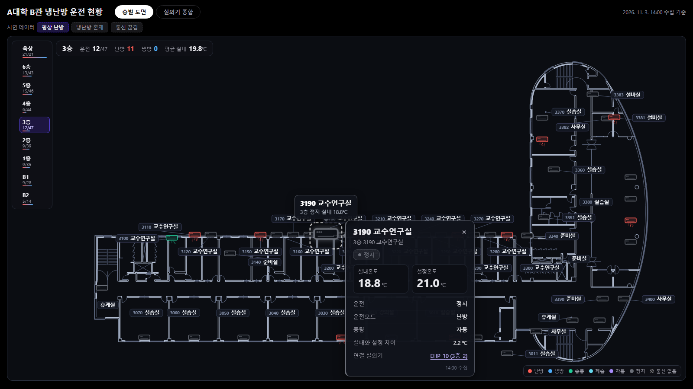
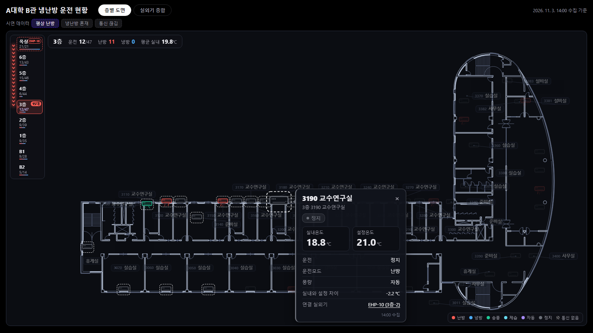
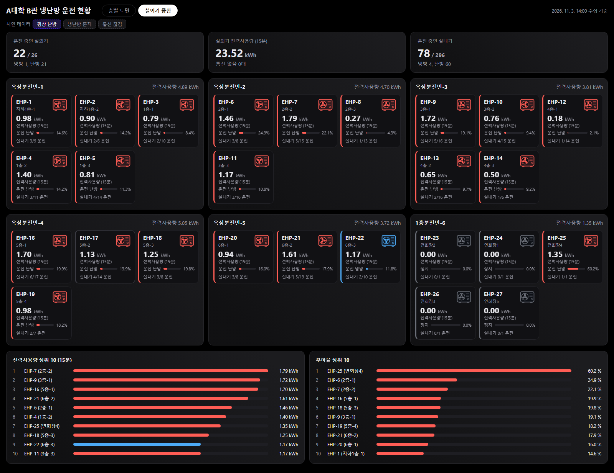

# Campus EHP Floor Monitor

대학 강의동의 EHP(시스템 냉난방) 실내기와 실외기를 층별 도면 위에 실시간으로 보여 주는 모니터링 화면 샘플입니다. EMS 화면 안에 넣어 쓰는 것을 전제로, 빌드 도구 없이 HTML, SVG, CSS, JavaScript로 만들었습니다.

모든 값은 시연용 가짜 데이터(`data/mock-scenarios.js`)입니다. 건물명은 A대학 B관으로, 호실명은 강의실, 실습실 같은 용도 이름으로 바꿨고, 도면은 좌우를 뒤집어 실제 건물과 다르게 보이게 했습니다.

라이브 데모: https://bob-joosayo.github.io/campus-ehp-floor-monitor/

- [층별 도면](https://bob-joosayo.github.io/campus-ehp-floor-monitor/floor.html?floor=3F)
- [옥상 실외기](https://bob-joosayo.github.io/campus-ehp-floor-monitor/floor.html?floor=RF)
- [실외기 종합](https://bob-joosayo.github.io/campus-ehp-floor-monitor/outdoor.html)
- [아이콘 상태 견본](https://bob-joosayo.github.io/campus-ehp-floor-monitor/states.html)


## 규모

| 항목 | 수량 |
|---|---|
| 층 | 지하 2층부터 6층, 옥상까지 9개 |
| 실내기 | 296대 (호실 196개) |
| 실외기 | 26대 (옥상 21대, 1층 5대) |
| 분전반 | 6개 |
| 포인트 | 1,778개 (실내기 5개씩, 실외기 7개씩과 지표 4개씩, 분전반) |

## 화면

| 파일 | 내용 |
|---|---|
| `floor.html` | 층별 도면. 실내기, 실외기 아이콘이 운전 상태와 모드에 따라 움직이고, 누르면 정보 카드가 붙는다 |
| `outdoor.html` | 실외기 종합. 분전반별 실외기 카드, 15분 전력사용량과 부하율 순위 |
| `states.html` | 실내기, 실외기 아이콘의 상태별 견본 |

| 실내기를 눌렀을 때 | 연결 실외기의 실내기 강조 |
|---|---|
|  |  |

| 옥상 실외기 | 실외기 종합 |
|---|---|
|  |  |

- 확대 없이 읽히도록 도면을 화면에 꽉 채우고, 층 선택과 요약, 범례는 도면 위에 작게 띄웠습니다.
- 호실명은 꼬리표로 그리고, 좁은 방이 줄지어 있으면 겹치지 않게 비켜 놓은 뒤 가는 선으로 잇습니다.
- 마우스를 올리면 아이콘과 이름이 커지고, 누르면 정보 카드가 붙습니다. 카드는 빈 곳을 눌러도 남고 닫기 버튼으로만 닫힙니다.
- 실외기 카드의 연결 실내기 보기를 누르면 소속 실내기만 남기고 나머지를 흐리게 하며, 다른 층에 있으면 층 버튼에 화살표가 흐릅니다.

## 데이터

EMS는 설비일괄등록으로 포인트를 시스템에 등록하고, 10자리 포인트ID(설비코드 4 + 포인트코드 4 + 호기 2)로 화면 항목에 값을 연결합니다. 이 화면도 같은 방식입니다.

- `data/point-map.js`: 설비일괄등록 엑셀과 실내기 위치 표를 합쳐 스크립트로 만든 설비, 포인트 정의. 실내기마다 소속 층, 호실, 도면 좌표, 연결 실외기, 포인트ID 5개(운전, 운전모드, 풍량, 설정온도, 실내온도)를 가진다.
- `data/floors.js`: 준공 CAD 도면(DXF)에서 벽, 기둥, 창, 계단 레이어만 뽑아 층별 SVG로 만든 것. 치수, 해치, 가구, 배관 레이어는 뺐고, 평면 밖 말풍선 호실명은 화면이 꼬리표로 다시 그린다.

## 상태 판정

| 대상 | 기준 |
|---|---|
| 실내기 | 운전(ON/OFF)과 운전모드(냉방, 난방, 송풍, 제습, 자동). 풍량에 따라 바람 애니메이션 속도가 바뀐다 |
| 실외기 | 전력(순시) > 0이면 운전. 현장 ON/OFF 포인트에 0, 1 외의 값이 들어와 운전 판정에 쓰지 않는다 |
| 부하율 | 일괄등록 수식이 ON/OFF를 조건으로 써서, 운전 중인데 0%가 나오면 `-`로 보여 준다 |
| 통신 없음 | 값이 없거나 30분보다 오래되면 빗금으로 표시하고 마지막 값을 숨긴다 |

같은 실외기에 묶인 운전 중 실내기 중 냉방과 난방이 섞여 있으면 실외기 카드에 냉난방 혼재를 붙입니다.

## 실행

빌드가 필요 없습니다. `floor.html`을 브라우저로 바로 열면 됩니다 (`file://`에서도 동작).

```bash
python -m http.server 8000
# http://localhost:8000/floor.html
```

- `floor.html?floor=3F`: 층 지정 (`RF`는 옥상)
- `floor.html?od=11`: 그 실외기에 묶인 실내기를 강조하며 열기

화면 위 시연 데이터 버튼으로 시나리오를 바꿀 수 있습니다.

| 시나리오 | 내용 |
|---|---|
| 평상 난방 | 실내기 약 27% 운전, 대부분 난방 |
| 냉난방 혼재 | 한 실외기에 냉방 2대, 난방 5대가 함께 운전 |
| 통신 끊김 | 한쪽 DDC 전체가 2시간 전 값으로 멈춤 |

## 구조

```
assets/
  ehp-viz.js    공통 엔진: 값 조회, 상태 판정, 실내기와 실외기 아이콘, 상단 탭, 갱신 주기
  ehp-viz.css   다크 테마와 애니메이션. 모든 규칙을 .ehp-viz 아래로 한정
  floor.js      층별 도면: 맞춤 배치, 호실명 꼬리표 자리 잡기, 정보 카드, 강조
  outdoor.js    실외기 종합
data/
  point-map.js       설비, 포인트 정의 (자동 생성)
  floors.js          층별 도면 SVG와 좌표 변환값 (자동 생성)
  mock-scenarios.js  시연용 데이터
```

## 실데이터 연동

화면은 `{ 포인트ID: { v: 값, ts: epoch ms } }` 형태의 최신값만 알면 됩니다. 공급 함수를 넣으면 시연 데이터와 시연 버튼은 자동으로 꺼집니다.

```js
EhpViz.setProvider(async () => fetchLatest(EhpViz.allPointIds()));
EhpViz.config.refreshMs = 60 * 1000;
```

## 애니메이션

- 실내기(벽걸이형): 운전 중이면 본체 아래로 모드별 바람이 흐른다. 난방은 빨간 물결, 냉방은 파란 화살표와 눈꽃, 제습은 물방울, 자동은 보라 바람과 신호 표시.
- 실외기: 원형 팬 안 프로펠러가 돌고, 전력이 클수록 빠르다.
- 한 층에 실내기가 47대까지 있어 CSS `transform`만 쓰고 SVG 필터는 쓰지 않았다. `prefers-reduced-motion` 설정이면 움직임을 끈다.
