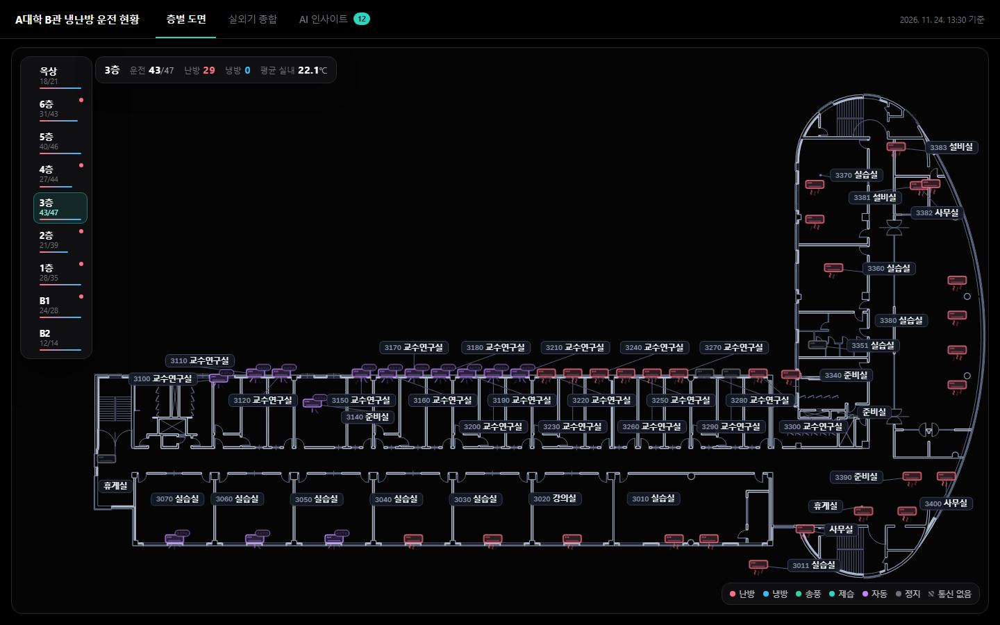
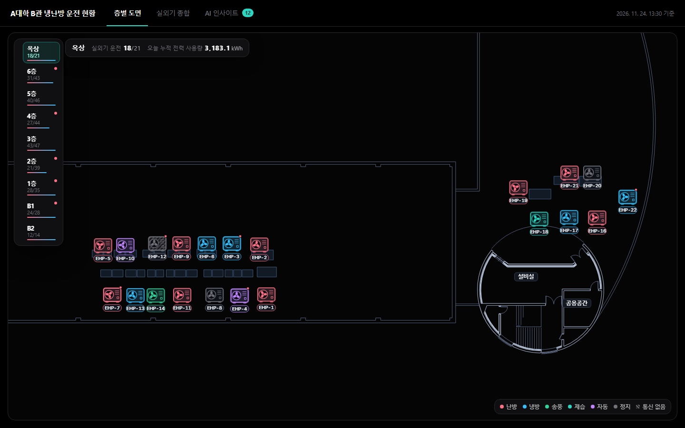

# Campus EHP Floor Monitor

대학 강의동 EHP(시스템 냉난방) 실내기와 실외기를 층별 도면 위에 실시간으로 보여 주는 모니터링 화면 샘플입니다. EMS 화면 안에 넣어 쓰는 것을 전제로, 빌드 도구 없이 HTML, SVG, CSS, JavaScript로 만들었습니다.

모든 값은 시연용 가짜 데이터(`data/mock-scenarios.js`)입니다. 건물명은 A대학 B관으로, 호실명은 강의실, 실습실 같은 용도 이름으로 바꿨고, 도면은 좌우를 뒤집어 실제 건물과 다르게 보이게 했습니다.

라이브 데모: https://bob-joosayo.github.io/campus-ehp-floor-monitor/

- [층별 도면](https://bob-joosayo.github.io/campus-ehp-floor-monitor/floor.html?floor=3F)
- [옥상 실외기](https://bob-joosayo.github.io/campus-ehp-floor-monitor/floor.html?floor=RF)
- [실외기 종합](https://bob-joosayo.github.io/campus-ehp-floor-monitor/outdoor.html)
- [AI 인사이트](https://bob-joosayo.github.io/campus-ehp-floor-monitor/insight.html)
- [아이콘 상태 견본](https://bob-joosayo.github.io/campus-ehp-floor-monitor/states.html)



## 규모

| 항목 | 수량 |
|---|---|
| 층 | 지하 2층부터 6층, 옥상까지 9개 |
| 실내기 | 296대 (호실 196개) |
| 실외기 | 26대 (옥상 21대, 1층 5대) |
| 분전반 | 6개 |
| 포인트 | 1,778개 (실내기 5개씩, 실외기 지표 포함, 분전반) |

## 화면

| 파일 | 내용 |
|---|---|
| `floor.html` | 층별 도면. 실내기, 실외기 아이콘이 운전 상태와 모드에 따라 움직이고, 누르면 정보 카드가 붙는다 |
| `outdoor.html` | 실외기 종합. 분전반별 실외기 카드, 전력사용량과 부하율 순위 |
| `insight.html` | AI 인사이트. 규칙 기반 알람(LLM 없음), 일/월/연, 층·유형 필터, 운전 패턴(15분) |
| `states.html` | 실내기, 실외기 아이콘의 상태별 견본 |

| 실내기를 눌렀을 때 | 연결 실외기의 실내기 강조 |
|---|---|
|  |  |

| 옥상 실외기 | 실외기 종합 |
|---|---|
|  |  |

- 확대 없이 읽히도록 도면을 화면에 꽉 채우고, 층 선택과 요약, 범례는 도면 위에 작게 띄웠습니다.
- 호실명은 꼬리표로 그리고, 좁은 방이 줄지어 있으면 겹치지 않게 비켜 놓은 뒤 가는 선으로 잇습니다.
- 마우스를 올리면 아이콘과 이름이 커지고, 누르면 정보 카드가 붙습니다. 카드는 빈 곳을 눌러도 남고 닫기 버튼으로만 닫힙니다.
- 인사이트에서 도면으로 넘어가면 `?iu=` / `?od=`로 **해당 기기만** 선택합니다. 실외기에 안 묶인 실내기는 카드에 "연결된 실외기 없음"을 보여 줍니다.

## AI 인사이트 (규칙 6종)

LLM 없이 포인트 상태로 판정합니다. KPI는 선택한 일/월/연 기간과 같이 움직입니다.

| 규칙 | 요지 |
|---|---|
| 심야 연속 운전 | 실내기 운전 + 설정한 심야 구간 |
| 방학·휴일형 운전 | 실외기 운전 + 설정한 방학 기간 |
| 계절과 모드 불일치 | 한여름 난방 / 한겨울 냉방 |
| 설정온도 이상 | 16~30℃ 밖, 냉방·난방별 이상 설정, 실내와 설정 차이 5℃ 이상 |
| 전력 패턴 이상 | 실외기 운전 + 부하율 95% 이상 |
| 통신 끊김 장기화 | 값 없음 또는 수집 30분 초과 |

운전 패턴(일)은 EMS 15분 이력을 가정해 시간 칸을 0~4칸 높이로 채웁니다.

## 데이터

EMS는 설비일괄등록으로 포인트를 시스템에 등록하고, 10자리 포인트ID(설비코드 4 + 포인트코드 4 + 호기 2)로 화면 항목에 값을 연결합니다. 이 화면도 같은 방식입니다.

개발 납품용으로는 **매핑번호 / 포인트이름 / 포인트10자리** 세 열짜리 매핑테이블 규격을 씁니다. 화면·코드는 매핑번호를 가리키고, 실제 조회는 포인트10자리로 치환합니다. (이 공개 샘플은 시연용으로 `point-map.js`의 포인트ID를 직접 읽습니다.)

- `data/point-map.js`: 설비, 포인트 정의. 실내기마다 소속 층, 호실, 도면 좌표, 연결 실외기, 포인트ID 5개
- `data/floors.js`: 준공 CAD에서 벽, 기둥, 창, 계단만 뽑아 층별 SVG로 만든 것

## 상태 판정

| 대상 | 기준 |
|---|---|
| 실내기 | 운전(ON/OFF)과 운전모드(냉방, 난방, 송풍, 제습, 자동). 풍량에 따라 바람 애니메이션 |
| 실외기 | 전력(순시) > 0이면 운전. ON/OFF는 쓰지 않음 |
| 통신 없음 | 값 없음 또는 수집 시각이 30분을 넘음 |

## 로컬 실행

```bash
python -m http.server 8781
# http://127.0.0.1:8781/floor.html
```

`file://`로도 열립니다. 실연동 시 `assets/provider-ems.js`를 채우고 `mock-scenarios.js`를 빼면 됩니다.

## 라이선스

샘플·시연용입니다. 실제 건물명과 호실명은 공개본에서 바꿨습니다.
