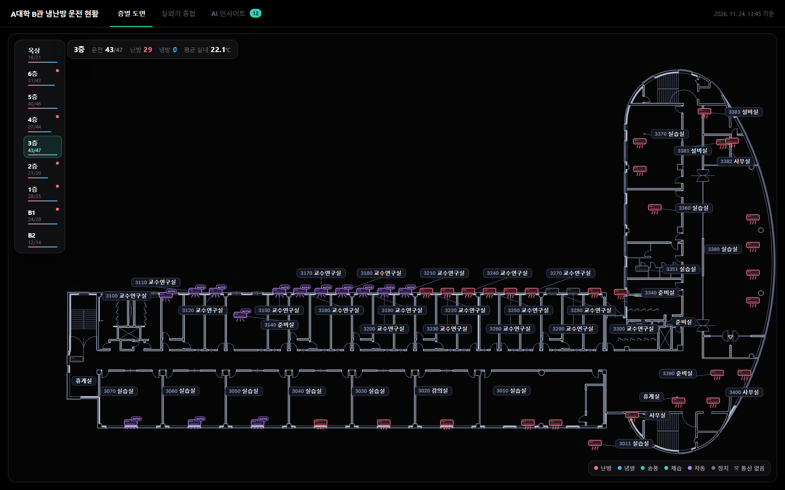
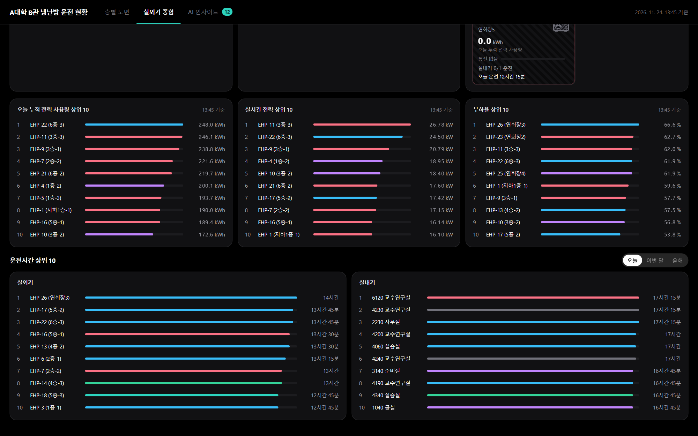
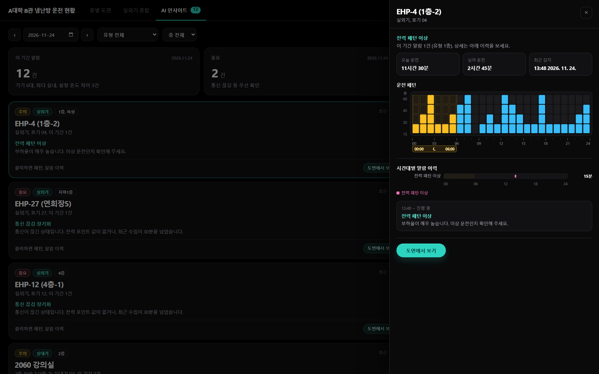

# Campus EHP Floor Monitor

대학 강의동의 EHP(시스템 냉난방) 실내기와 실외기를 층별 도면 위에 보여 주는 모니터링 화면 샘플입니다. EMS 화면 안에 넣어 쓰는 것을 전제로, 빌드 도구 없이 HTML, SVG, CSS, JavaScript로 만들었습니다.

모든 값은 시연용 가짜 데이터(`data/mock-scenarios.js`)입니다. 건물명은 A대학 B관으로, 호실명은 강의실, 실습실 같은 용도 이름으로 바꿨고, 도면은 좌우를 뒤집어 실제 건물과 다르게 보이게 했습니다.

라이브 데모: https://bob-joosayo.github.io/campus-ehp-floor-monitor/

- [층별 도면](https://bob-joosayo.github.io/campus-ehp-floor-monitor/floor.html?floor=3F)
- [옥상 실외기](https://bob-joosayo.github.io/campus-ehp-floor-monitor/floor.html?floor=RF)
- [실외기 종합](https://bob-joosayo.github.io/campus-ehp-floor-monitor/outdoor.html)
- [AI 인사이트](https://bob-joosayo.github.io/campus-ehp-floor-monitor/insight.html)
- [아이콘 상태 견본](https://bob-joosayo.github.io/campus-ehp-floor-monitor/states.html)



## 규모

| 항목 | 수량 |
|---|---|
| 층 | 지하 2층부터 6층, 옥상까지 9개 |
| 실내기 | 296대 (호실 196개) |
| 실외기 | 26대 (옥상 21대, 1층 5대) |
| 분전반 | 6개 |
| 포인트 | 1,778개 (실내기 5개씩, 실외기 7개씩과 지표 4개씩, 분전반) |

## 화면

| 파일 | 내용 |
|---|---|
| `floor.html` | 층별 도면. 실내기, 실외기 아이콘이 운전 상태와 모드에 따라 움직이고, 누르면 정보 카드가 붙는다 |
| `outdoor.html` | 실외기 종합. KPI, 분전반별 카드, 오늘 누적/실시간/부하 랭킹, 운전시간 상위 10 |
| `insight.html` | AI 인사이트. 일자별 알람 이력, 기기 카드, 상세 드로어(운전 패턴, 시간대별 이력) |
| `states.html` | 실내기, 실외기 아이콘의 상태별 견본 |

| 실내기를 눌렀을 때 | 연결 실외기의 실내기 강조 |
|---|---|
|  |  |

| 옥상 실외기 | 실외기 종합 |
|---|---|
|  |  |

| 실외기 랭킹 (누적/실시간/부하/운전시간) | AI 인사이트 목록 |
|---|---|
|  |  |

| AI 인사이트 상세 드로어 |
|---|
|  |

### 층별 도면

- 확대 없이 읽히도록 도면을 화면에 꽉 채우고, 층 선택과 요약, 범례는 도면 위에 작게 띄웠습니다.
- 호실명은 꼬리표로 그리고, 좁은 방이 줄지어 있으면 겹치지 않게 비켜 놓은 뒤 가는 선으로 잇습니다.
- 아이콘을 누르면 정보 카드가 붙고, 도면 밖을 누르면 닫힙니다.
- 실외기 카드의 연결 실내기 보기를 누르면 소속 실내기만 남기고 나머지를 흐리게 하며, 다른 층에 있으면 층 버튼에 화살표가 흐릅니다.
- 카드의 「목록에서 보기」는 인사이트 화면으로 넘기며, 해당 기기가 목록 맨 앞에 오고 상세가 열립니다.

### 실외기 종합

- KPI: 운전 중인 실외기/실내기 수, 오늘 누적 전력 사용량(천 단위 콤마).
- 호기 카드: 오늘 누적 kWh, 운전 모드, 부하율 막대, 연결 실내기 운전 수, 오늘 운전시간.
- 랭킹: 오늘 누적 전력, 실시간 전력, 부하율 상위 10. 숫자는 자리수 드럼으로 바뀝니다.
- 운전시간 상위 10: 오늘 / 이번 달 / 올해 전환(Tab Pill). 문자열은 한 줄 롤로 바뀝니다.

### AI 인사이트

- 일자 이동, 유형/층 필터, 방학, 심야 설정.
- 알람 유형: 심야 연속 운전, 방학, 휴일형 운전, 계절과 모드 불일치, 설정온도 이상, 실내와 설정 온도 차이, 전력 패턴 이상, 통신 끊김 장기화.
- 상세: 15분 칸 운전 패턴, 시간대별 알람 레인(합산은 15분 단위), 「도면에서 보기」로 해당 설비 포커스.

## 최근 반영 (v1.4 최종)

- 숫자 자리수 드럼과 천 단위 콤마 (`3,261.5`)
- Tab Pill, 운전시간 문구 롤
- 표기: 「오늘 누적 전력 사용량」, 「실시간 전력 상위 10」
- 실내와 설정 온도 차이: 절대값
- 알람 합산/시연 슬롯: 15분 단위 (1분 표기 없음)
- 도면과 인사이트 딥링크 (`?iu=` / `?od=`)
- 연결 실외기, 도면에서 보기 등 칩 버튼 UI

## 데이터

EMS는 설비일괄등록으로 포인트를 시스템에 등록하고, 10자리 포인트ID(설비코드 4 + 포인트코드 4 + 호기 2)로 화면 항목에 값을 연결합니다. 이 화면도 같은 방식입니다. 화면에서 외부 API를 직접 호출해 포인트를 가져오는 구조가 아닙니다.

- `data/point-map.js`: 설비, 포인트 정의 (공개용으로 호실명 치환)
- `data/floors.js`: 층별 SVG와 좌표 (좌우 반전)
- `data/mock-scenarios.js`: 15분 슬롯 시연 스냅샷, 운전분, 알람 이력

전력 표기:

| 구분 | 단위 | 화면 |
|---|---|---|
| 오늘 누적 전력 사용량 | kWh | KPI, 카드, 누적 랭킹 |
| 실시간 전력 | kW | 도면 실외기 상세, 실시간 전력 상위 10 |
| 부하율 | % | 실외기 카드 막대, 부하율 랭킹 |

## 상태 판정

| 대상 | 기준 |
|---|---|
| 실내기 | 운전(ON/OFF)과 운전모드(냉방, 난방, 송풍, 제습, 자동). 풍량에 따라 바람 애니메이션 속도가 바뀐다 |
| 실외기 | 전력(순시) > 0이면 운전 |
| 부하율 | 운전 중인데 0%가 나오면 `-`로 보여 준다 |
| 통신 없음 | 값이 없거나 30분보다 오래되면 빗금으로 표시하고 마지막 값을 숨긴다 |

## 실행

빌드가 필요 없습니다. `floor.html`을 브라우저로 바로 열면 됩니다.

```bash
python -m http.server 8000
# http://localhost:8000/floor.html
```

- `floor.html?floor=3F`: 층 지정 (`RF`는 옥상)
- `floor.html?od=11`: 그 실외기에 묶인 실내기를 강조하며 열기
- `floor.html?iu=05`: 해당 실내기 선택
- `insight.html?od=27` / `insight.html?iu=05`: 인사이트에서 해당 기기 맨 앞 + 상세 열기

## 구조

```
assets/
  ehp-viz.js         공통 엔진: 값 조회, 상태 판정, 아이콘, 상단 탭
  ehp-viz.css        다크 테마, 드럼, 칩, 패턴 차트
  ehp-motion.js      Tab Pill, 숫자 드럼, 문구 롤
  floor.js           층별 도면
  outdoor.js         실외기 종합
  insight.js         AI 인사이트 화면
  insight-engine.js  알람 판정과 설정
data/
  point-map.js       설비, 포인트 정의 (익명화)
  floors.js          층별 도면 SVG (좌우 반전)
  mock-scenarios.js  시연용 데이터
```

## 실데이터 연동

화면은 `{ 포인트ID: { v: 값, ts: epoch ms, day?: 당일합 } }` 형태의 최신값만 알면 됩니다. 공급 함수를 넣으면 시연 데이터는 자동으로 꺼집니다.

```js
EhpViz.setProvider(async () => fetchLatest(EhpViz.allPointIds()));
EhpViz.config.refreshMs = 60 * 1000;
```

## 애니메이션

- 실내기: 운전 중이면 모드별 바람. 난방은 빨간 물결, 냉방은 파란 화살표와 눈꽃 등.
- 실외기: 팬이 돌고, 전력이 클수록 빠르다.
- 숫자: 자리수 드럼. 운전시간 문구는 세로 롤.
- `prefers-reduced-motion`이면 움직임을 끈다.
