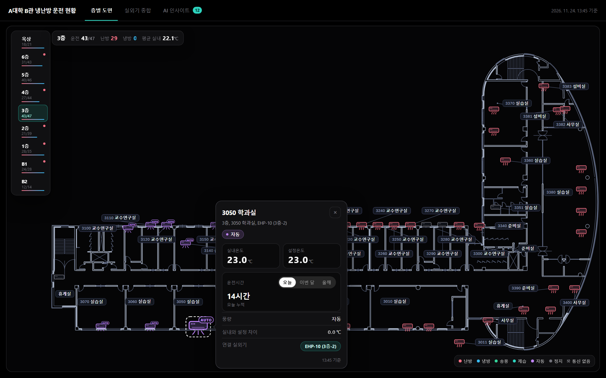
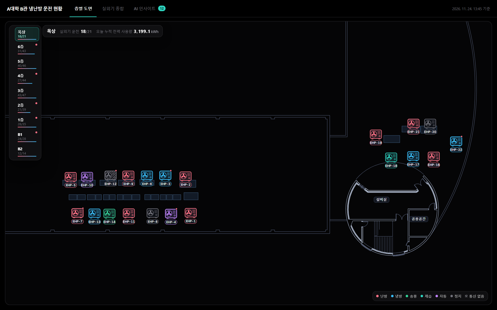
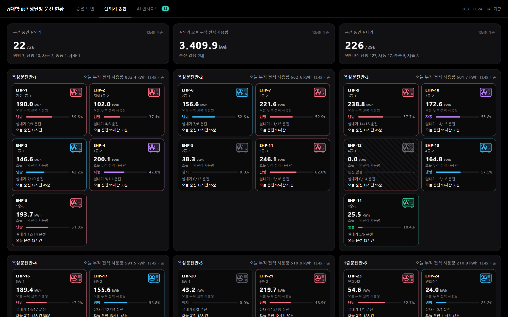
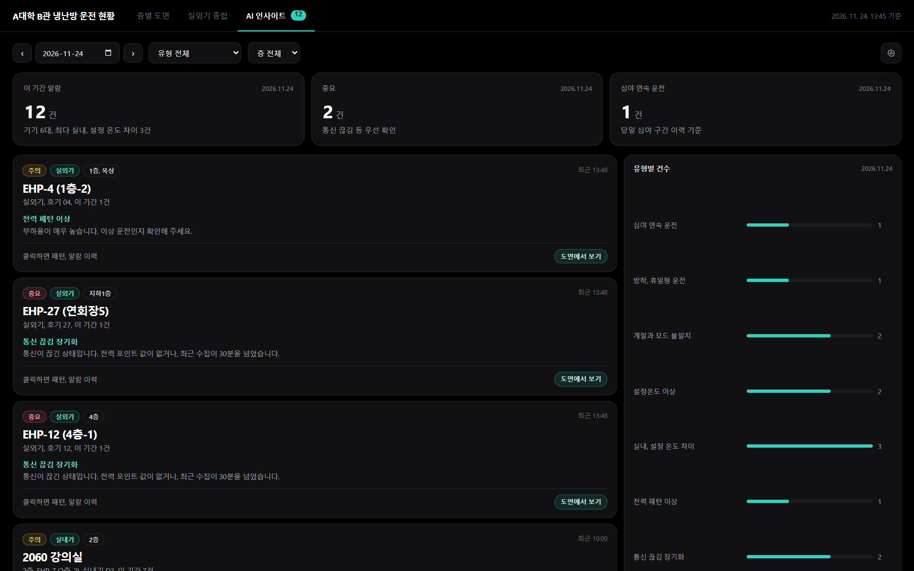

# Campus EHP Floor Monitor

대학 건물 냉난방(EHP) 운전 현황을 도면 위에서 보는 모니터링 화면입니다.  
층별 도면, 실외기 종합, 이상 운전 알람(AI 인사이트)까지 한 흐름으로 구성했습니다.

시연용 데이터 기준이며, 건물명은 A대학 B관으로 표기했습니다.

**데모:** [https://bob-joosayo.github.io/campus-ehp-floor-monitor/](https://bob-joosayo.github.io/campus-ehp-floor-monitor/)

- [층별 도면](https://bob-joosayo.github.io/campus-ehp-floor-monitor/floor.html?floor=3F)
- [옥상 실외기](https://bob-joosayo.github.io/campus-ehp-floor-monitor/floor.html?floor=RF)
- [실외기 종합](https://bob-joosayo.github.io/campus-ehp-floor-monitor/outdoor.html)
- [AI 인사이트](https://bob-joosayo.github.io/campus-ehp-floor-monitor/insight.html)

지하 2층부터 6층, 옥상까지 9개 층. 실내기 296대, 실외기 26대 규모입니다.

## 화면 구성

아이콘을 누르면 온도, 전력, 운전시간이 카드로 붙습니다.  
실외기에서 연결 실내기를 고르면 해당 기기만 남기고 나머지를 흐리게 보여 줍니다.

| 실내기 선택 | 연결 실내기만 강조 |
|---|---|
|  |  |

| 옥상 실외기 배치 | 실외기 종합 |
|---|---|
|  |  |

실외기 화면에서는 오늘 누적 전력, 실시간 전력, 부하율, 운전시간 상위 목록을 같이 볼 수 있습니다.

AI 인사이트에서는 심야 연속 운전, 설정온도 이상, 통신 끊김 같은 알람을 모아 두고,  
해당 기기를 도면에서 바로 찾아갈 수 있게 했습니다.

| 알람 목록 | 상세 |
|---|---|
|  |  |

HTML, SVG, CSS, JavaScript만으로 만들었고 별도 빌드는 없습니다.
